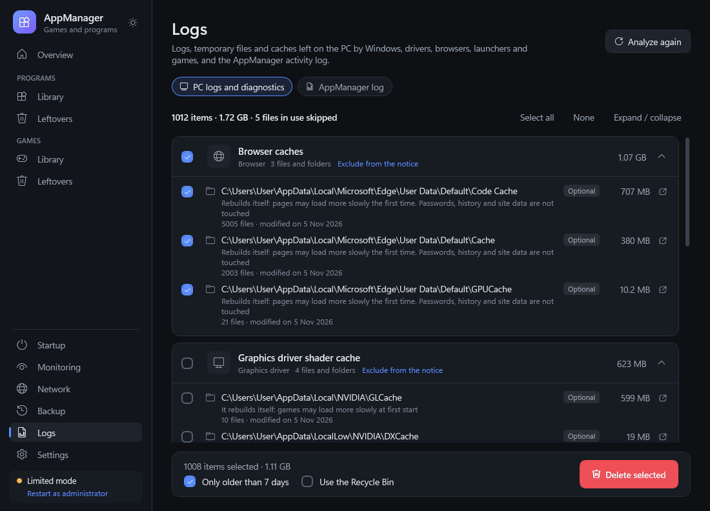
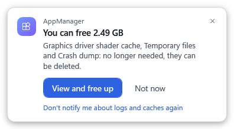

# AppManager

**Spiele und Programme unter Windows verwalten und vollständig entfernen.**
AppManager deinstalliert ein Spiel oder Programm und findet danach alles, was es und Windows zurückgelassen haben: Spielstände, Einstellungen, Caches, Screenshots, Registrierungseinträge, Autostart-Einträge, geplante Aufgaben, Dienste, Dateitypen, Kontextmenü-Einträge, Firewall-Regeln und Verknüpfungen. Nichts wird gelöscht, bevor du die Liste gesehen und bestätigt hast.

[English](README.md) · [Italiano](README.it.md) · [Français](README.fr.md) · **Deutsch** · [Español](README.es.md) · [Русский](README.ru.md) · [Українська](README.uk.md)

**[Herunterladen](../../releases/latest)** · Windows 10 / 11 · portabel, ohne Installation · 7 Sprachen · dunkles und helles Design


---

## Auf einen Blick

- **Alles Installierte an einem Ort**: Steam, Epic Games, GOG, Ubisoft Connect, EA app, Battle.net, Rockstar, Amazon Games, Xbox / PC Game Pass, Apps aus dem Microsoft Store, klassische Installer, Repacks und **portable** Kopien.
- **Deinstallieren und bereinigen**: startet das richtige Deinstallationsprogramm, wartet, bis es fertig ist, und zeigt dann jeden Rest nach Kategorien, mit dem Grund, warum er gefunden wurde, und wie sicher AppManager ist („Sicher“, „Wahrscheinlich“, „Zu prüfen“).
- **Reste von Apps, die schon weg sind**, auch von Spielen, die von Hand gelöscht wurden.
- **Überwachung im Hintergrund** (optional): verfolgt Installationen und Deinstallationen aus dem Infobereich und meldet sich, wenn eine Deinstallation etwas zurückgelassen hat.
- **Protokolle und Caches**: Windows-Protokolle und temporäre Dateien, Windows-Update-Downloads, Treiberprotokolle und -pakete, Caches von Browsern, Launchern, Spielen und Shadern, mit einem optionalen Hinweis, wenn sie zu viel Platz belegen.
- **Spielstandverwaltung**: Backups, mehrere Spielstand-Profile pro Spiel, „neues Spiel“, ohne das alte zu verlieren.
- **Sicherheit zuerst**: Papierkorb und Zip-Backup vor dem Löschen, geschützte Systembereiche, nichts wird ohne deine Bestätigung gelöscht.
- **Immer portabel**: alles liegt in einem Ordner `Dati` neben dem Programm; jeder PC hat sein eigenes Profil.

## Screenshots

Die Screenshots zeigen die englische Version; das Programm folgt der Sprache von Windows.

### Übersicht
Der PC auf einen Blick: wie lange er läuft, wann Windows installiert wurde, was sich seit dem letzten Start geändert hat, Speicherplatz und was am meisten belegt. Die Liste der Spiele und Programme lässt sich als CSV exportieren.


### Spiele
Alle installierten Spiele mit Cover, Größe und Launcher. Das Detailfeld zeigt Ordner, Publisher und wie das Spiel gefunden wurde, und bietet schnellen Zugriff auf Spielstände, Deinstallation, Start, Ordner und Internetsperre. Fehlende Cover werden online gesucht (Steam, PCGamingWiki, optionaler SteamGridDB-Schlüssel, Wikipedia). Ohne Cover wird das Symbol des Spiels verwendet.


Spiele werden auch ohne Launcher gefunden: an den Spuren von Spiel-Engines (Unity, Unreal, CryEngine, Source, RPG Maker, Ren'Py…), an Signaturen von Cracks und Steam-Emulatoren (CODEX, RUNE, EMPRESS, Goldberg…), an Repack-Namen, an Spielen, die von Hand zu Steam hinzugefügt wurden, und an Programmen, die Windows als gestartet gespeichert hat, egal wo sie liegen.

### Programme
Installierte Programme, Apps aus dem Microsoft Store, Steam-Tools und portable Programme. Laufzeitumgebungen, Treiber und in Windows enthaltene Apps sind hinter „Windows-Komponenten anzeigen“ verborgen, damit sie nicht versehentlich entfernt werden. Ein portables Programm in einem Entwicklungsprojekt oder einem Ordner mit Dokumenten wird nur als seine ausführbare Datei vorgeschlagen, nie als ganzer Ordner.


### Deinstallieren und bereinigen
AppManager startet die richtige Deinstallation (Steam, das Deinstallationsprogramm, Windows für Store-Apps, direktes Entfernen bei portablen Kopien). Wenn sie fertig ist, sucht er nach Resten.


Die Reste sind nach Kategorien geordnet. Einträge „Sicher“ und „Wahrscheinlich“ sind vorausgewählt, Einträge „Zu prüfen“ nicht. Dasselbe Fenster, geöffnet mit **Daten**, zeigt die Daten eines Spiels oder Programms, ohne etwas zu deinstallieren.


Was gesucht wird, zusätzlich zu den Datenordnern in `AppData`, `ProgramData` und `Dokumente`:
- Autostart-Einträge (Run, RunOnce, Status im Task-Manager, Autostart-Ordner), geplante Aufgaben und Dienste des Programms;
- Dateitypen, „Öffnen mit“-Einträge, Standard-Apps, Kontextmenü, COM-Komponenten und Shell-Erweiterungen;
- zum `PATH` hinzugefügte Ordner, Benachrichtigungseinstellungen, Startverlauf, Kompatibilität, GPU-Einstellungen, Firewall-Regeln;
- bei Spielen: Steam-Daten, Unity- und Unreal-Ordner, Spielstände in `My Games` und `Gespeicherte Spiele`, Ordner von Steam-Emulatoren, Shader-Caches.

Systemeinträge werden nur vorgeschlagen, wenn sie wirklich zum Programm gehören: Was auf Windows verweist, wird nie angerührt.

### Reste bereits entfernter Apps
Eine einzige Analyse findet die Reste von Spielen und Programmen, die nicht mehr installiert sind oder von Hand gelöscht wurden, und teilt sie auf die Bereiche Spiele und Programme auf. Eindeutig Verwaistes wird ausgewählt; kürzlich genutzte Daten ohne diesen Nachweis bleiben „Zu prüfen“.


### Überwachung im Hintergrund
Standardmäßig aus. Eingeschaltet startet AppManager mit Windows und bleibt im Infobereich. Er verfolgt die Deinstallationseinträge von Windows sowie die Bibliotheken von Steam und Epic. Verschwindet ein Programm oder Spiel, wartet er, bis das Deinstallationsprogramm fertig und sein Ordner weg ist, und sucht dann nach Resten: Der Hinweis kommt meist wenige Sekunden später.


Ist etwas übrig geblieben, erscheint ein Hinweis über dem Infobereich, ohne die Taskleiste zu verdecken. **Ansehen und entfernen** öffnet die Liste, **Ignorieren** schließt sie. Der Hinweis verschwindet nach 20 Sekunden und wartet, solange ein Spiel im Vollbild oder eine Präsentation läuft. Folgen mehrere Deinstallationen aufeinander, sammelt derselbe Hinweis sie alle. Die Seite **Überwachung** bewahrt den Verlauf auf: Installationen, Updates und Deinstallationen, auch die mit AppManager, mit dem, was übrig blieb, und dem, was schon entfernt wurde. Die Überwachung löscht nie etwas von sich aus.


### Spielstände und Profile
Für jedes Spiel findet **Spielstände verwalten** die Spielstandordner selbst: Steam, `My Games`, `Gespeicherte Spiele`, `AppData`, Unity- und Unreal-Ordner, Ordner von Steam-Emulatoren, die inoffizielle Kopien nutzen, und den Ordner des Spiels selbst, in dem viele portable Kopien speichern. Für Spielstände, die am Namen nicht erkennbar sind, fragt er auch PCGamingWiki; gesendet wird nur der Spieltitel.
- **Spielstand-Backups** als Zip-Dateien, jederzeit wiederherstellbar. Vor jeder Wiederherstellung werden die aktuellen Spielstände zuerst gesichert.
- **Profile**: mehrere Spielstand-Sätze für dasselbe Spiel, zum Beispiel einer pro Spieler.
- **Neues Spiel**: legt die aktuellen Spielstände beiseite und beginnt von vorn; zum vorherigen Profil kehrst du zurück, wann du willst.


### Protokolle und Caches
Die Seite **Protokolle** findet, was sich leeren lässt, ohne etwas zu verlieren: Windows-Protokolle (Updates, Wartung, Installation), temporäre Dateien von Windows und vom Benutzer, Downloads von Windows Update und der Übermittlungsoptimierung, Fehlerberichte und Absturz-Dumps, Protokolle der Grafiktreiber und ihre bereits entpackten Installationspakete, Protokolle von Launchern und Spielen, Browser-Caches (Edge, Chrome, Brave, Vivaldi, Opera, Firefox) und Shader-Caches. Passwörter, Verlauf und Websitedaten werden nie angerührt, ebenso wenig Komponenten, die Treiber brauchen (etwa die DLSS-Dateien von NVIDIA). Windows-Ereignisprotokolle und Dateien in Verwendung werden übersprungen.



Ist die Überwachung eingeschaltet, meldet sich AppManager, wenn sie mehr als das in den Einstellungen gewählte Limit belegen (standardmäßig 1 GB). Er prüft höchstens alle 6 Stunden. **Nicht jetzt** verschiebt den Hinweis um 7 Tage. In den Einstellungen wählst du mit je einem Schalter pro Kategorie, was geprüft wird (Windows, temporäre Dateien, Windows-Updates, Grafiktreiber, Browser, Launcher, Spiele), und jede Gruppe der Seite Protokolle lässt sich einzeln ausnehmen.



### Autostart und Netzwerk
**Autostart** listet die Programme auf, die mit Windows starten, und schaltet sie wie der Task-Manager ein oder aus. Ausschalten löscht nichts.


**Netzwerk** zeigt in Echtzeit, welche laufenden Programme verbunden sind und wohin. Du kannst ein einzelnes Ziel sperren oder den gesamten Internetzugang eines Programms, über die Windows-Firewall. Jede Regel lässt sich in den Einstellungen mit einem Klick entfernen.


### Einstellungen
Design (hell, dunkel oder wie Windows), Sprache, Speicherlimit für heruntergeladene Bilder, Voreinstellungen für Papierkorb und Backup, Überwachung im Hintergrund und Hinweis zu Protokollen und Caches, portable Ordner, Suchmethoden und Netzwerkregeln.


## Sicherheit

- **Nichts wird ohne deine Bestätigung gelöscht.** Du siehst immer die vollständige Liste, mit Grund und Sicherheit jedes Eintrags.
- **Papierkorb und Backup**: Standardmäßig kommen gelöschte Dateien in den Papierkorb, in einen Ordner pro Anwendung, mit ihren vollständigen Pfaden. Auch Systemeinträge werden dort gespeichert, als `.reg`-, `.xml`- und `.txt`-Dateien. Spielstände, Einstellungen und Systemeinträge werden außerdem in ein Zip-Backup kopiert, das im Bereich **Backups** wiederhergestellt werden kann. Schlägt das Backup fehl, beginnt die Bereinigung nicht.
- **Geschützte Bereiche**: Windows, die Hauptordner von Program Files und ProgramData, Windows-Komponenten, die Benutzerordner (Dokumente, Desktop, Downloads, AppData…), Systemordner im Stammverzeichnis der Laufwerke, Launcher und die Ordner aller installierten Spiele und Programme. Ein Ordner, der einen geschützten enthält, wird nie gelöscht.
- **Verknüpfungen werden nie verfolgt**: Entfernt wird nur die Junction oder der symbolische Link selbst, nie das Ziel.
- **Ungewöhnliche Pfade** (Kurznamen, Variablen, `..`, Netzwerk- und `\\?\`-Pfade) werden vor jeder Prüfung auf den echten Pfad zurückgeführt oder abgelehnt. Pfade über 260 Zeichen werden unterstützt.
- **Nur eine Instanz gleichzeitig**, Einstellungen werden atomar gespeichert und jeder Vorgang im Aktivitätsprotokoll festgehalten.

## Datenschutz

AppManager geht nur ins Internet, um Spiel-Cover und Spielstandordner zu suchen. Für Spielstände fragt er PCGamingWiki und sendet dabei nur den Spieltitel. Beide Suchen lassen sich abschalten. Der optionale SteamGridDB-Schlüssel wird nur an SteamGridDB gesendet. Keine Telemetrie. Jeder PC wird an einem anonymen Fingerabdruck seiner Windows-ID erkannt; die ID selbst wird nie gespeichert oder gesendet.

## Sprachen

English, Italiano, Français, Deutsch, Español, Русский, Українська. Die Sprache folgt Windows (Englisch, wenn sie nicht verfügbar ist) und lässt sich in den Einstellungen ändern.

## Herunterladen und verwenden

1. Lade `AppManager.exe` aus der [neuesten Version](../../releases/latest) herunter.
2. Lege sie in einen beliebigen Ordner, auch auf einen USB-Stick, und starte sie. Windows fragt nach Administratorrechten; sie werden für Prefetch, System-Registrierungsschlüssel, Dienste, geplante Systemaufgaben und Firewall-Regeln gebraucht. Ohne sie läuft AppManager im „Eingeschränkten Modus“ und findet und bereinigt trotzdem die Daten deines Benutzers.

Voraussetzungen: Windows 10 oder 11. Er nutzt .NET Framework 4.8, das in Windows bereits enthalten ist. Zum Aktualisieren `AppManager.exe` ersetzen: Der Ordner `Dati` bleibt.

**Tastatur**: Strg+F Suche · F5 Aktualisieren · Entf deinstalliert den ausgewählten Eintrag (öffnet nur die Bestätigung) · Esc Schließen · Eingabe Bestätigen (nie bei Aktionen, die etwas löschen).

## Aus dem Quellcode kompilieren

Visual Studio ist nicht nötig: Der in Windows enthaltene C#-Compiler genügt (C# 5, .NET Framework 4.8).

```
cd Source
powershell -ExecutionPolicy Bypass -File build.ps1
```

`build.ps1 -AsInvoker` erstellt `bin\AppManager.Test.exe` ohne Administratoranfrage, für Tests. `build.ps1 -Harness` erstellt zusätzlich `tools\Harness.exe`, das Testwerkzeug für die Konsole:

| Befehl | Was er prüft |
|---|---|
| `robust <Ordner>` | Grenzfälle: geschützte Pfade, Verknüpfungen, lange Pfade, Unicode-Namen, gesperrte Dateien, manipulierte Backups (nur Testdaten) |
| `invariants` | nur lesend: alles, was die Analysen auf diesem PC vorschlagen, hält die Sicherheitsregeln ein |
| `savetest <Ordner>` | Spielstandverwaltung: Backups, neues Spiel, Profilwechsel, Rücknahme bei Fehlern, Wiederherstellung |
| `recycletest <Ordner>` | nach Anwendung geordneter Papierkorb, ohne den echten Papierkorb zu benutzen |
| `pctest <Ordner>` | PC-Erkennung, Ressourcen, Autostart, Export, Übersetzungen, Erkennung von Raub- und portablen Kopien, Logik der Überwachung |
| `logtest <Ordner>` | Aktivitätsprotokoll |
| `watchtest <Ordner>` | vollständiger Test der Überwachung mit einer Test-Anwendung, die der Test anlegt und wieder entfernt |

`pctest`, `logtest` und `watchtest` brauchen `APPMANAGER_DATA` auf demselben Testordner, `savetest` und `recycletest` auf einem anderen.

### Projektstruktur

```
Source/
  src/core   Erkennung, Suche nach Resten, Bereinigung, Backups, Spielstände, Überwachung (ohne Oberfläche)
  src/app    WPF-ViewModels, Symbol im Infobereich, Hinweise
  ui         XAML (wird beim Start geladen) und Übersetzungen in ui/lang/*.txt
  tools      Testwerkzeug für die Konsole (Harness)
  build.ps1  Build-Skript
docs/images  Screenshots
```

Die Texte sind im Code und im XAML auf Italienisch geschrieben und dienen als Schlüssel; die Übersetzungen liegen in `ui/lang/*.txt`.

## Lizenz

[MIT](LICENSE) © Crover81
