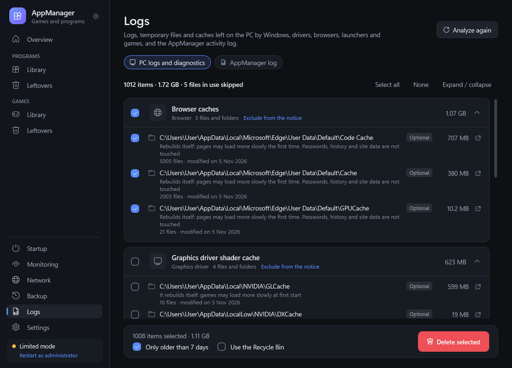
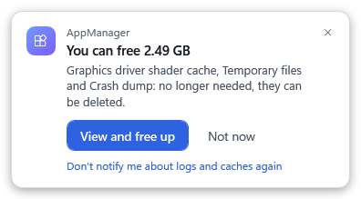

# AppManager

**Gestiona tus juegos y programas en Windows y elimínalos por completo.**
AppManager desinstala un juego o un programa y después encuentra todo lo que él y Windows dejaron atrás: partidas guardadas, ajustes, cachés, capturas de pantalla, entradas del registro, inicios automáticos, tareas programadas, servicios, tipos de archivo, entradas del menú contextual, reglas del firewall y accesos directos. No se elimina nada hasta que hayas visto la lista y confirmado.

[English](README.md) · [Italiano](README.it.md) · [Français](README.fr.md) · [Deutsch](README.de.md) · **Español** · [Русский](README.ru.md) · [Українська](README.uk.md)

**[Descargar](../../releases/latest)** · Windows 10 / 11 · portable, sin instalación · 7 idiomas · tema oscuro y claro


---

## En resumen

- **Todo lo instalado, en un solo lugar**: Steam, Epic Games, GOG, Ubisoft Connect, EA app, Battle.net, Rockstar, Amazon Games, Xbox / PC Game Pass, apps de Microsoft Store, instaladores clásicos, repacks y copias **portables**.
- **Desinstalar y limpiar**: abre el desinstalador correcto, espera a que termine y muestra cada resto agrupado por categoría, con el motivo por el que se encontró y lo seguro que está AppManager («Seguro», «Probable», «Por comprobar»).
- **Restos de apps que ya no están**, incluidos los juegos borrados a mano.
- **Vigilancia en segundo plano** (opcional): sigue instalaciones y desinstalaciones desde el área de notificación y te avisa cuando una desinstalación ha dejado algo.
- **Registros y cachés**: registros y archivos temporales de Windows, descargas de Windows Update, registros y paquetes de controladores, cachés de navegadores, lanzadores, juegos y sombreadores, con un aviso opcional cuando ocupan demasiado espacio.
- **Gestor de partidas**: copias de seguridad, varios perfiles de partidas por juego, «partida nueva» sin perder la anterior.
- **Primero la seguridad**: Papelera y copia zip antes de eliminar, zonas del sistema protegidas, nunca se elimina nada sin tu confirmación.
- **Siempre portable**: todo está en una carpeta `Dati` junto al programa; cada PC tiene su propio perfil.

## Capturas

Las capturas son de la versión en inglés; el programa sigue el idioma de Windows.

### Resumen
El PC de un vistazo: cuánto tiempo lleva encendido, cuándo se instaló Windows, qué ha cambiado desde el último inicio, el espacio en disco y qué ocupa más. La lista de juegos y programas se exporta a CSV.


### Juegos
Todos los juegos instalados con portada, tamaño y lanzador. El panel de detalle muestra la carpeta, el editor y cómo se encontró el juego, y da acceso rápido a partidas, desinstalación, inicio, carpeta y bloqueo de Internet. Las portadas que faltan se buscan en línea (Steam, PCGamingWiki, clave opcional de SteamGridDB, Wikipedia). Sin portada se usa el icono del juego.


Los juegos se encuentran incluso sin lanzador: por las huellas de los motores de juego (Unity, Unreal, CryEngine, Source, RPG Maker, Ren'Py…), por las firmas de cracks y emuladores de Steam (CODEX, RUNE, EMPRESS, Goldberg…), por los nombres de repacks, por los juegos añadidos a Steam a mano y por los ejecutables que Windows recuerda haber abierto, estén donde estén.

### Programas
Programas instalados, apps de Microsoft Store, herramientas de Steam y programas portables. Los runtimes, controladores y apps incluidas en Windows están ocultos tras «Mostrar los componentes de Windows», para no quitarlos por error. Un programa portable dentro de un proyecto de desarrollo o de una carpeta de documentos se propone solo como su ejecutable, nunca la carpeta entera.


### Desinstalar y limpiar
AppManager inicia la desinstalación adecuada (Steam, el desinstalador del programa, Windows para las apps de la Store, eliminación directa para las copias portables). Cuando termina, busca los restos.


Los restos se agrupan por categoría. Los elementos «Seguro» y «Probable» vienen seleccionados; los «Por comprobar», no. La misma ventana, abierta con **Datos**, muestra los datos de un juego o programa sin desinstalar nada.


Qué se busca, además de las carpetas de datos en `AppData`, `ProgramData` y `Documentos`:
- inicios automáticos (Run, RunOnce, estado en el Administrador de tareas, carpeta Inicio), tareas programadas y servicios del programa;
- tipos de archivo, entradas «Abrir con», apps predeterminadas, menú contextual, componentes COM y extensiones del shell;
- carpetas añadidas al `PATH`, ajustes de notificaciones, historial de inicio, compatibilidad, preferencias de GPU, reglas del firewall;
- en los juegos: datos de Steam, carpetas de Unity y Unreal, partidas en `My Games` y `Juegos guardados`, carpetas de emuladores de Steam, cachés de sombreadores.

Las entradas del sistema solo se proponen si son realmente del programa: lo que apunta a Windows nunca se toca.

### Restos de apps ya eliminadas
Un único análisis encuentra los restos de juegos y programas que ya no están instalados, o que se borraron a mano, y los reparte entre las secciones Juegos y Programas. Lo que está claramente huérfano se selecciona; los datos usados hace poco sin esa prueba quedan «Por comprobar».


### Vigilancia en segundo plano
Desactivada de serie. Si la activas, AppManager se inicia con Windows y permanece en el área de notificación. Sigue las entradas de desinstalación de Windows y las bibliotecas de Steam y Epic. Cuando desaparece un programa o un juego, espera a que termine el desinstalador y a que su carpeta desaparezca, y luego busca los restos: el aviso suele llegar pocos segundos después.


Si ha quedado algo, aparece un aviso encima del área de notificación, sin tapar la barra de tareas. **Ver y eliminar** abre la lista e **Ignorar** la cierra. El aviso desaparece a los 20 segundos y espera mientras haya un juego a pantalla completa o una presentación. Si hay varias desinstalaciones seguidas, el mismo aviso las reúne. La página **Vigilancia** guarda el historial: instalaciones, actualizaciones y desinstalaciones, también las hechas con AppManager, con lo que quedó y lo que ya se eliminó. La vigilancia nunca elimina nada por su cuenta.


### Partidas y perfiles
Para cada juego, **Gestionar partidas** encuentra solo sus carpetas de partidas: Steam, `My Games`, `Juegos guardados`, `AppData`, carpetas de Unity y Unreal, carpetas de emuladores de Steam usadas por copias no oficiales y la propia carpeta del juego, donde guardan muchas copias portables. Para las partidas que no se reconocen por el nombre consulta también PCGamingWiki; solo se envía el título del juego.
- **Copias de las partidas** en archivos zip, restaurables cuando quieras. Antes de cada restauración se hace primero una copia de las partidas actuales.
- **Perfiles**: varios conjuntos de partidas para el mismo juego, por ejemplo uno por jugador.
- **Partida nueva**: aparta las partidas actuales y empieza de cero; vuelves al perfil anterior cuando quieras.


### Registros y cachés
La página **Registros** encuentra lo que se puede vaciar sin perder nada: registros de Windows (actualizaciones, mantenimiento, instalación), archivos temporales de Windows y del usuario, descargas de Windows Update y de Optimización de distribución, informes de errores y volcados, registros de los controladores de vídeo y sus paquetes de instalación ya extraídos, registros de lanzadores y juegos, cachés de navegadores (Edge, Chrome, Brave, Vivaldi, Opera, Firefox) y de sombreadores. Las contraseñas, el historial y los datos de los sitios nunca se tocan, ni los componentes que necesitan los controladores (como los archivos DLSS de NVIDIA). Los registros de eventos de Windows y los archivos en uso se omiten.



Con la vigilancia activada, AppManager te avisa cuando superan el límite elegido en los Ajustes (1 GB de serie). Comprueba como mucho cada 6 horas. **Ahora no** aplaza el aviso 7 días. En los Ajustes eliges qué comprobar, con un interruptor por categoría (Windows, archivos temporales, actualizaciones de Windows, controladores de vídeo, navegadores, lanzadores, juegos), y cada grupo de la página Registros se puede excluir por separado.



### Inicio automático y red
**Inicio automático** muestra los programas que se inician con Windows y los activa o desactiva como el Administrador de tareas. Desactivar no elimina nada.


**Red** muestra en tiempo real qué programas en ejecución están conectados y hacia dónde. Puedes bloquear un solo destino, o todo el acceso a Internet de un programa, con el Firewall de Windows. Cada regla se quita con un clic desde los Ajustes.


### Ajustes
Tema (claro, oscuro o como Windows), idioma, límite de espacio para las imágenes descargadas, opciones predeterminadas de Papelera y copia de seguridad, vigilancia en segundo plano y aviso de registros y cachés, carpetas portables, métodos de búsqueda y reglas de red.


## Seguridad

- **No se elimina nada sin tu confirmación.** Siempre ves la lista completa, con el motivo y la fiabilidad de cada elemento.
- **Papelera y copia de seguridad**: de serie, los archivos eliminados van a la Papelera, en una carpeta por aplicación, con sus rutas completas. Allí se guardan también las entradas del sistema, como archivos `.reg`, `.xml` y `.txt`. Partidas, ajustes y entradas del sistema se copian además en una copia zip, restaurable desde la sección **Copias**. Si la copia falla, la limpieza no empieza.
- **Zonas protegidas**: Windows, las carpetas principales de Program Files y ProgramData, los componentes de Windows, las carpetas del usuario (Documentos, Escritorio, Descargas, AppData…), las carpetas del sistema en la raíz de los discos, los lanzadores y las carpetas de todos los juegos y programas instalados. Nunca se elimina una carpeta que contenga otra protegida.
- **Los enlaces nunca se siguen**: solo se quita la unión o el enlace simbólico, nunca aquello a lo que apunta.
- **Rutas raras** (nombres cortos, variables, `..`, rutas de red y `\\?\`) se convierten en la ruta real antes de cualquier comprobación, o se rechazan. Se admiten rutas de más de 260 caracteres.
- **Una sola copia abierta**, ajustes guardados de forma atómica y cada operación anotada en el registro de actividad.

## Privacidad

AppManager solo se conecta a Internet para buscar portadas de juegos y carpetas de partidas. Para las partidas consulta PCGamingWiki enviando solo el título del juego. Ambas búsquedas se pueden desactivar. La clave opcional de SteamGridDB solo se envía a SteamGridDB. No hay telemetría. Cada PC se reconoce por una huella anónima de su ID de Windows; el ID nunca se guarda ni se envía.

## Idiomas

English, Italiano, Français, Deutsch, Español, Русский, Українська. El idioma sigue al de Windows (inglés si no está disponible) y se cambia en los Ajustes.

## Descargar y usar

1. Descarga `AppManager.exe` desde la [última versión](../../releases/latest).
2. Ponlo en cualquier carpeta, incluso en una memoria USB, y ábrelo. Windows pide permisos de administrador; sirven para el Prefetch, las claves de registro del sistema, los servicios, las tareas programadas del sistema y las reglas del firewall. Sin ellos, AppManager funciona en «Modo limitado» y aun así encuentra y limpia los datos de tu usuario.

Requisitos: Windows 10 u 11. Usa .NET Framework 4.8, ya incluido en Windows. Para actualizar, sustituye `AppManager.exe`: la carpeta `Dati` se conserva.

**Teclado**: Ctrl+F busca · F5 actualiza · Supr desinstala el elemento seleccionado (solo abre la confirmación) · Esc cierra · Intro confirma (nunca en las acciones que eliminan algo).

## Compilar desde el código fuente

No hace falta Visual Studio: basta el compilador de C# incluido en Windows (C# 5, .NET Framework 4.8).

```
cd Source
powershell -ExecutionPolicy Bypass -File build.ps1
```

`build.ps1 -AsInvoker` crea `bin\AppManager.Test.exe` sin la petición de administrador, para las pruebas. `build.ps1 -Harness` crea también `tools\Harness.exe`, la herramienta de pruebas de consola:

| Comando | Qué comprueba |
|---|---|
| `robust <carpeta>` | casos límite: rutas protegidas, enlaces, rutas largas, nombres Unicode, archivos bloqueados, copias alteradas (solo datos de prueba) |
| `invariants` | solo lectura: todo lo que los análisis proponen en este PC respeta las reglas de seguridad |
| `savetest <carpeta>` | gestor de partidas: copias, partida nueva, cambio de perfil, deshacer en caso de error, restauración |
| `recycletest <carpeta>` | Papelera organizada por aplicación, sin usar la Papelera real |
| `pctest <carpeta>` | reconocimiento del PC, recursos, inicio automático, exportación, traducciones, detección de copias piratas y portables, lógica de la vigilancia |
| `logtest <carpeta>` | registro de actividad |
| `watchtest <carpeta>` | prueba completa de la vigilancia con una aplicación falsa que la prueba crea y luego quita |

`pctest`, `logtest` y `watchtest` necesitan `APPMANAGER_DATA` en la misma carpeta de prueba; `savetest` y `recycletest`, en una distinta.

### Estructura del proyecto

```
Source/
  src/core   detección, búsqueda de restos, limpieza, copias, partidas, vigilancia (sin interfaz)
  src/app    ViewModels de WPF, icono del área de notificación, avisos
  ui         XAML (se carga al iniciar) y traducciones en ui/lang/*.txt
  tools      herramienta de pruebas de consola (Harness)
  build.ps1  script de compilación
docs/images  capturas
```

Los textos están escritos en italiano en el código y en el XAML y sirven de claves; las traducciones están en `ui/lang/*.txt`.

## Licencia

[MIT](LICENSE) © Crover81
