# AppManager

**Управляйте играми и программами в Windows и удаляйте их полностью.**
AppManager удаляет игру или программу, а затем находит всё, что она и Windows оставили после себя: сохранения, настройки, кэш, скриншоты, записи реестра, элементы автозагрузки, задания планировщика, службы, типы файлов, пункты контекстного меню, правила брандмауэра и ярлыки. Ничего не удаляется, пока вы не увидите список и не подтвердите.

[English](README.md) · [Italiano](README.it.md) · [Français](README.fr.md) · [Deutsch](README.de.md) · [Español](README.es.md) · **Русский** · [Українська](README.uk.md)

**[Скачать](../../releases/latest)** · Windows 10 / 11 · портативная, без установки · 7 языков · тёмная и светлая тема

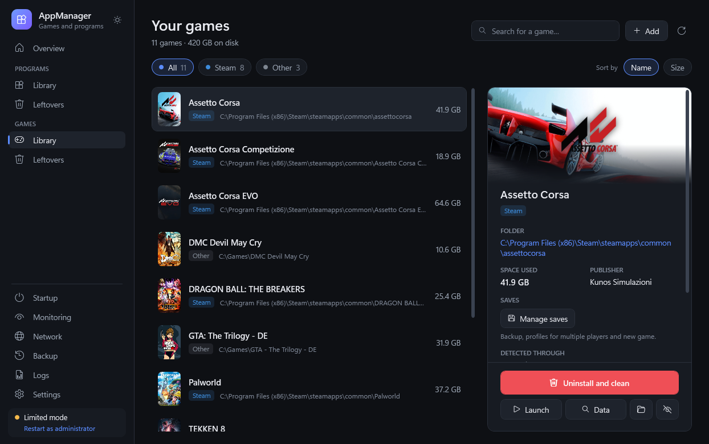

---

## Коротко

- **Всё установленное в одном месте**: Steam, Epic Games, GOG, Ubisoft Connect, EA app, Battle.net, Rockstar, Amazon Games, Xbox / PC Game Pass, приложения Microsoft Store, обычные установщики, репаки и **портативные** копии.
- **Удалить и очистить**: запускает нужный деинсталлятор, ждёт его завершения и показывает каждый остаток по категориям, с причиной, по которой он найден, и степенью уверенности AppManager («Точно», «Вероятно», «Проверить»).
- **Остатки уже исчезнувших приложений**, в том числе игр, удалённых вручную.
- **Наблюдение в фоне** (по желанию): следит за установкой и удалением программ из области уведомлений и сообщает, если после удаления что-то осталось.
- **Журналы и кэш**: журналы и временные файлы Windows, загрузки Центра обновления, журналы и пакеты драйверов, кэш браузеров, лаунчеров, игр и шейдеров, с необязательным уведомлением, когда они занимают слишком много места.
- **Менеджер сохранений**: резервные копии, несколько профилей сохранений для одной игры, «новая игра» без потери старой.
- **Безопасность прежде всего**: Корзина и zip-копия перед удалением, защищённые системные области, ничего не удаляется без вашего подтверждения.
- **Всегда портативная**: всё хранится в папке `Dati` рядом с программой; у каждого ПК свой профиль.

## Скриншоты

На скриншотах английская версия; программа использует язык Windows.

### Обзор
ПК с первого взгляда: сколько он работает, когда установлена Windows, что изменилось с последнего запуска, место на дисках и что занимает больше всего. Список игр и программ можно экспортировать в CSV.

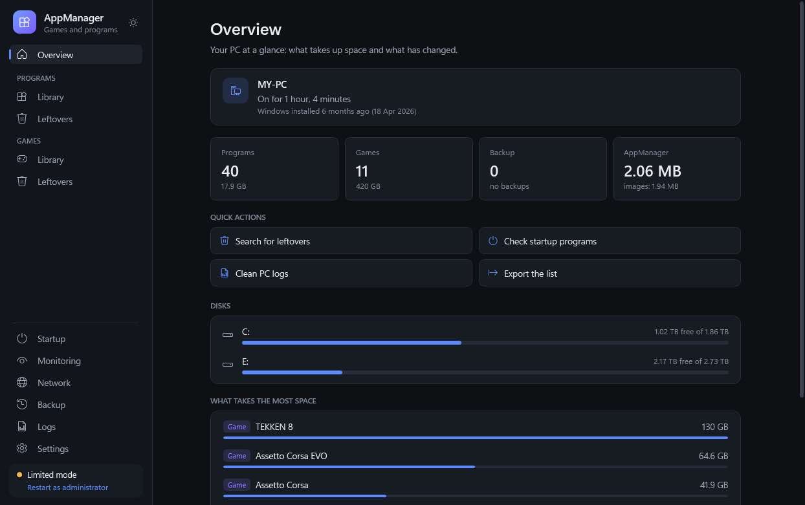

### Игры
Все установленные игры с обложкой, размером и лаунчером. Панель подробностей показывает папку, издателя и то, как была найдена игра, и даёт быстрый доступ к сохранениям, удалению, запуску, папке и блокировке интернета. Недостающие обложки ищутся в сети (Steam, PCGamingWiki, необязательный ключ SteamGridDB, Википедия). Если обложки нет, используется значок игры.

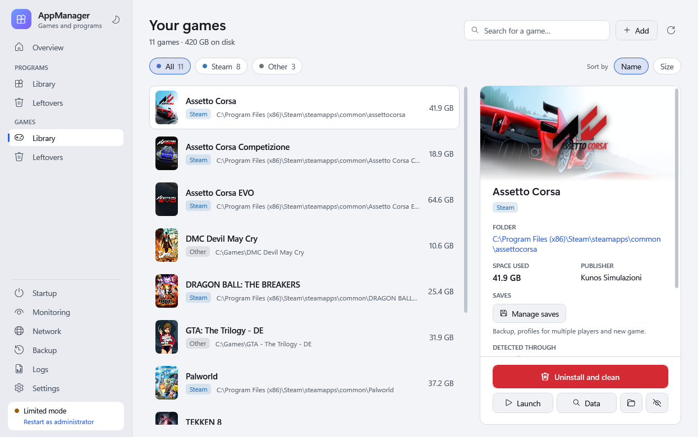

Игры находятся даже без лаунчера: по следам игровых движков (Unity, Unreal, CryEngine, Source, RPG Maker, Ren'Py…), по сигнатурам кряков и эмуляторов Steam (CODEX, RUNE, EMPRESS, Goldberg…), по названиям репаков, по играм, добавленным в Steam вручную, и по исполняемым файлам, которые Windows запоминает как запускавшиеся, где бы они ни находились.

### Программы
Установленные программы, приложения Microsoft Store, инструменты Steam и портативные программы. Среды выполнения, драйверы и встроенные приложения Windows скрыты за ссылкой «Показать компоненты Windows», чтобы их не удалить по ошибке. Портативная программа внутри проекта разработки или папки с документами предлагается только как её исполняемый файл, никогда как вся папка.

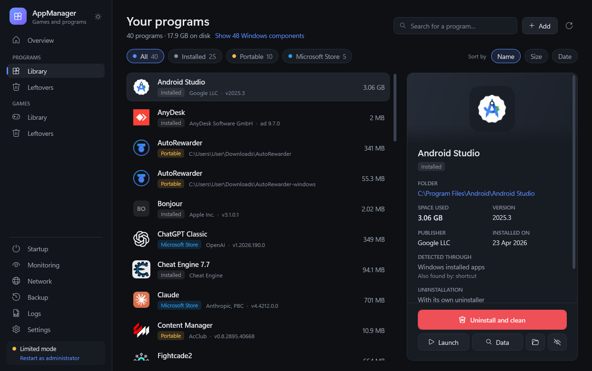

### Удалить и очистить
AppManager запускает правильное удаление (Steam, деинсталлятор программы, Windows для приложений Store, прямое удаление для портативных копий). Когда оно закончится, он ищет остатки.

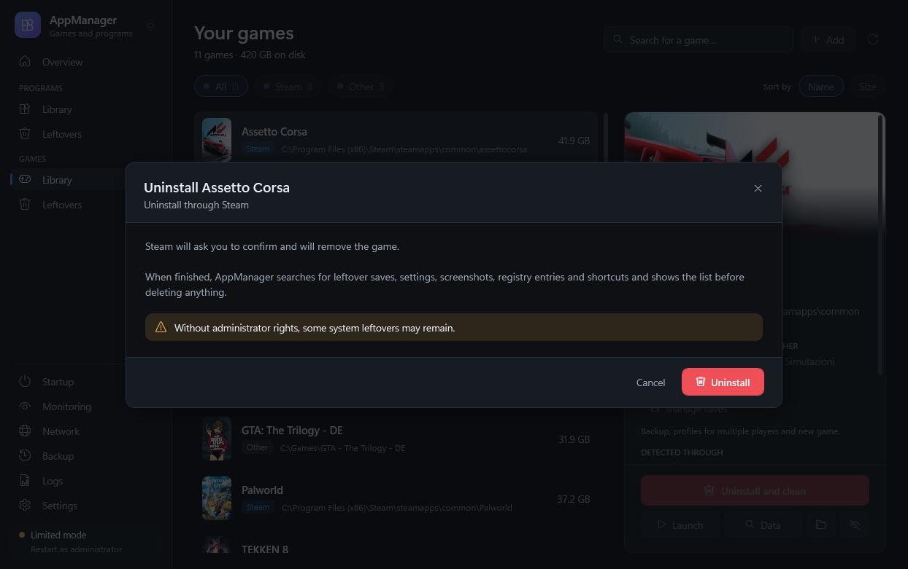

Остатки сгруппированы по категориям. Элементы «Точно» и «Вероятно» выбраны заранее, элементы «Проверить» — нет. То же окно, открытое кнопкой **Данные**, показывает данные игры или программы, ничего не удаляя.

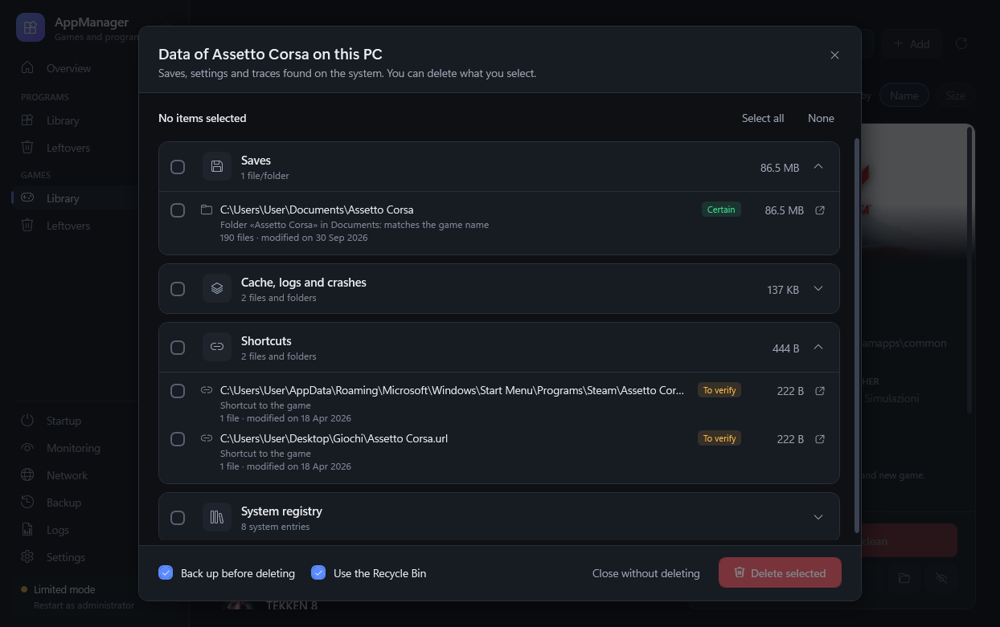

Что ищется, помимо папок с данными в `AppData`, `ProgramData` и «Документах»:
- элементы автозагрузки (Run, RunOnce, состояние в диспетчере задач, папка «Автозагрузка»), задания планировщика и службы программы;
- типы файлов, пункты «Открыть с помощью», приложения по умолчанию, контекстное меню, компоненты COM и расширения оболочки;
- папки, добавленные в `PATH`, настройки уведомлений, история запусков, совместимость, настройки GPU, правила брандмауэра;
- для игр: данные Steam, папки Unity и Unreal, сохранения в `My Games` и «Сохранённых играх», папки эмуляторов Steam, кэш шейдеров.

Системные записи предлагаются, только если они действительно принадлежат программе: всё, что указывает на Windows, никогда не трогается.

### Остатки уже удалённых приложений
Один анализ находит остатки игр и программ, которые больше не установлены или были удалены вручную, и делит их между разделами «Игры» и «Программы». Явно осиротевшее выбирается; недавно использованные данные без такого доказательства остаются «Проверить».

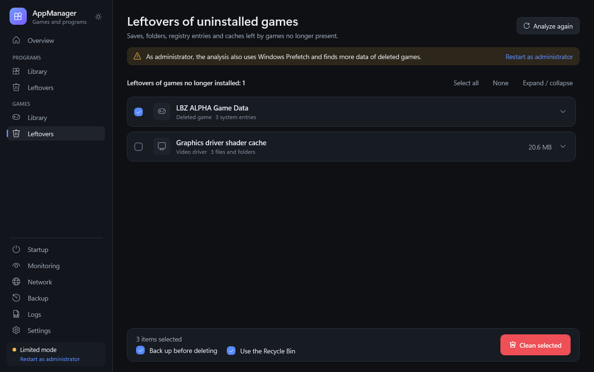

### Наблюдение в фоне
По умолчанию выключено. Если его включить, AppManager запускается вместе с Windows и остаётся в области уведомлений. Он следит за записями удаления Windows и библиотеками Steam и Epic. Когда программа или игра исчезает, он ждёт окончания работы деинсталлятора и исчезновения её папки, а затем ищет остатки: обычно уведомление приходит через несколько секунд.

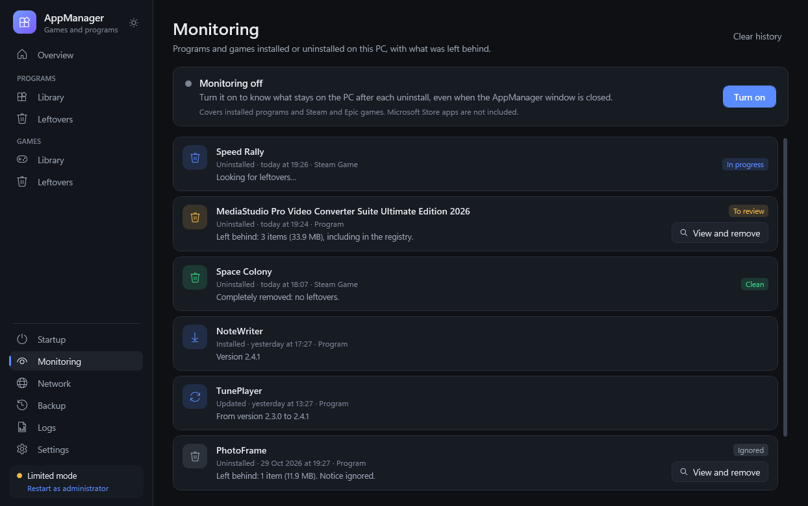

Если что-то осталось, над областью уведомлений появляется сообщение, не закрывающее панель задач. **Посмотреть и удалить** открывает список, **Игнорировать** закрывает его. Сообщение исчезает через 20 секунд и ждёт, пока идёт полноэкранная игра или презентация. Если удаления идут одно за другим, одно и то же сообщение собирает их все. Страница **Наблюдение** хранит историю: установки, обновления и удаления, в том числе сделанные через AppManager, с тем, что осталось, и тем, что уже удалено. Наблюдение никогда ничего не удаляет само.

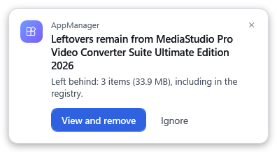

### Сохранения и профили
Для каждой игры **Управление сохранениями** само находит папки сохранений: Steam, `My Games`, «Сохранённые игры», `AppData`, папки Unity и Unreal, папки эмуляторов Steam, которыми пользуются неофициальные копии, и папку самой игры, куда сохраняют многие портативные копии. Для сохранений, которые нельзя распознать по имени, оно обращается и к PCGamingWiki; отправляется только название игры.
- **Резервные копии сохранений** в zip-файлах, восстанавливаемые в любой момент. Перед каждым восстановлением сначала сохраняется копия текущих сохранений.
- **Профили**: несколько наборов сохранений для одной игры, например по одному на каждого игрока.
- **Новая игра**: откладывает текущие сохранения и начинает с нуля; вернуться к прежнему профилю можно когда угодно.

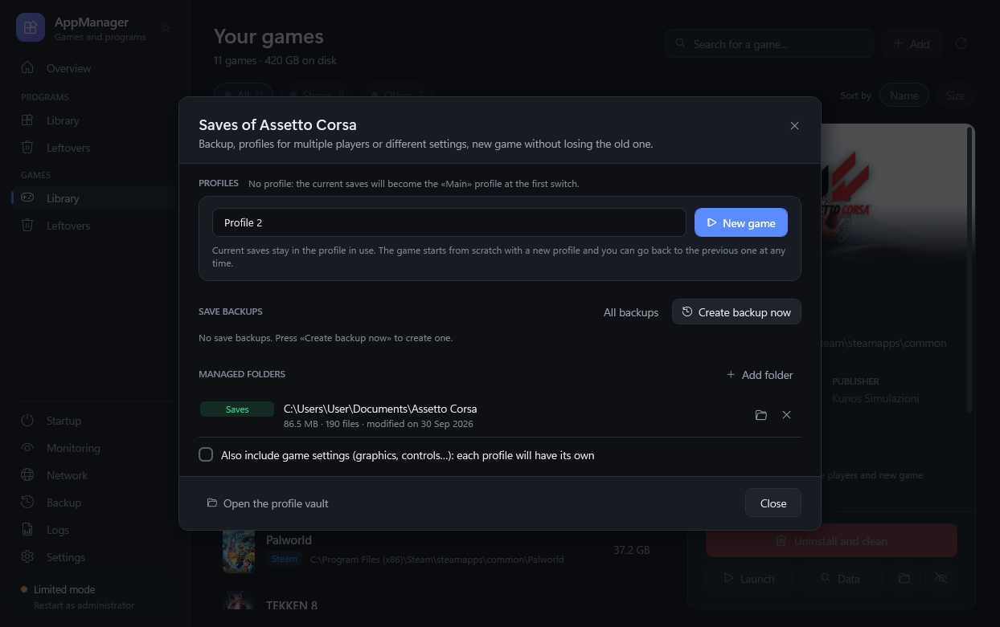

### Журналы и кэш
Страница **Журналы** находит то, что можно очистить без потерь: журналы Windows (обновления, обслуживание, установка), временные файлы Windows и пользователя, загрузки Центра обновления и оптимизации доставки, отчёты об ошибках и дампы, журналы видеодрайверов и их уже распакованные установочные пакеты, журналы лаунчеров и игр, кэш браузеров (Edge, Chrome, Brave, Vivaldi, Opera, Firefox) и шейдеров. Пароли, история и данные сайтов никогда не затрагиваются, как и компоненты, нужные драйверам (например, файлы DLSS от NVIDIA). Журналы событий Windows и используемые файлы пропускаются.

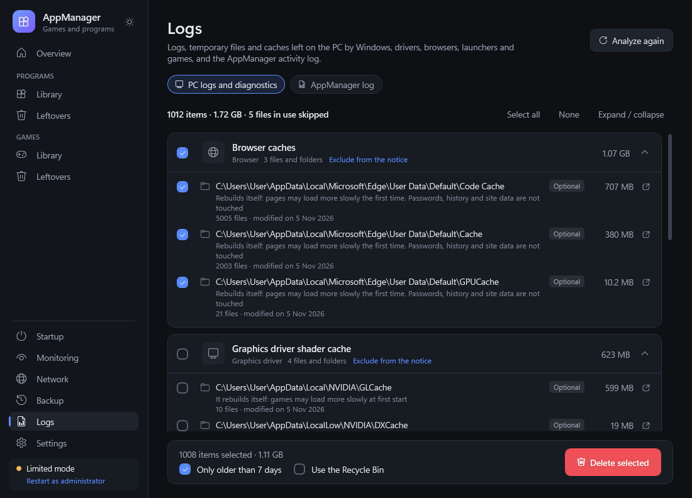

При включённом наблюдении AppManager сообщает, когда они занимают больше лимита, выбранного в настройках (по умолчанию 1 ГБ). Проверка — не чаще раза в 6 часов. **Не сейчас** откладывает уведомление на 7 дней. В настройках вы выбираете, что проверять, — по переключателю на категорию (Windows, временные файлы, обновления Windows, видеодрайверы, браузеры, лаунчеры, игры), а каждую группу на странице «Журналы» можно исключить отдельно.

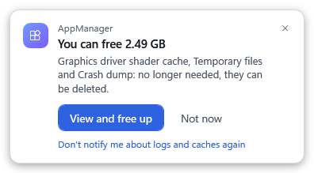

### Автозагрузка и сеть
**Автозагрузка** показывает программы, запускающиеся вместе с Windows, и включает или выключает их, как диспетчер задач. Выключение ничего не удаляет.

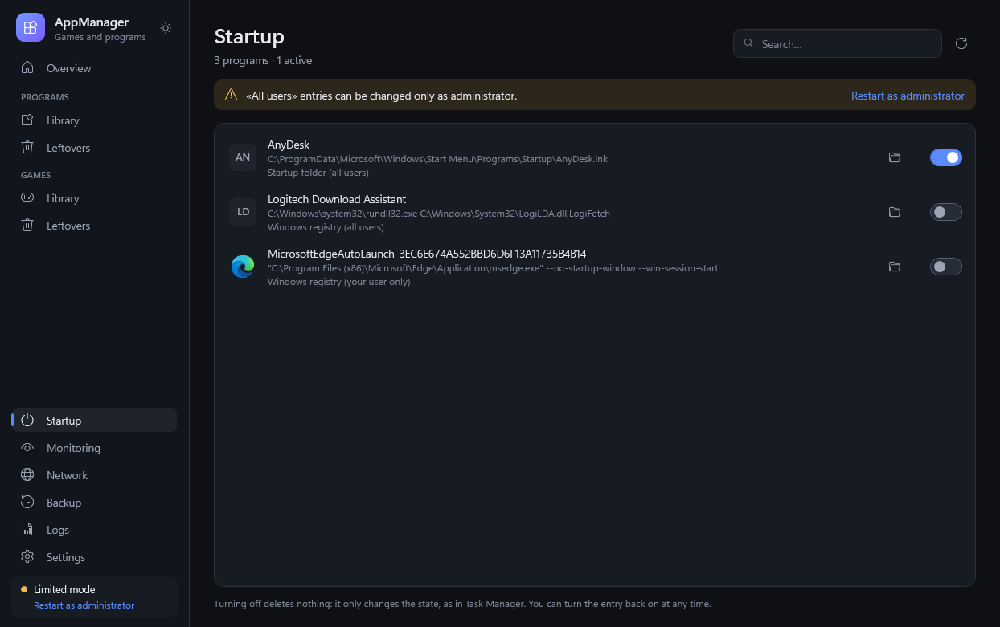

**Сеть** в реальном времени показывает, какие запущенные программы подключены и куда. Можно заблокировать одно направление или весь доступ программы к интернету через брандмауэр Windows. Каждое правило снимается одним щелчком в настройках.

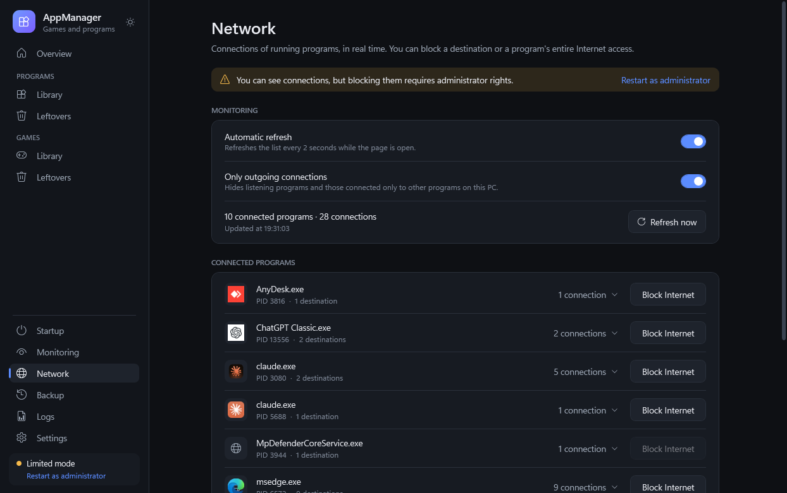

### Настройки
Тема (светлая, тёмная или как в Windows), язык, лимит места для загруженных изображений, значения по умолчанию для Корзины и резервной копии, наблюдение в фоне и уведомление о журналах и кэше, портативные папки, способы поиска и сетевые правила.

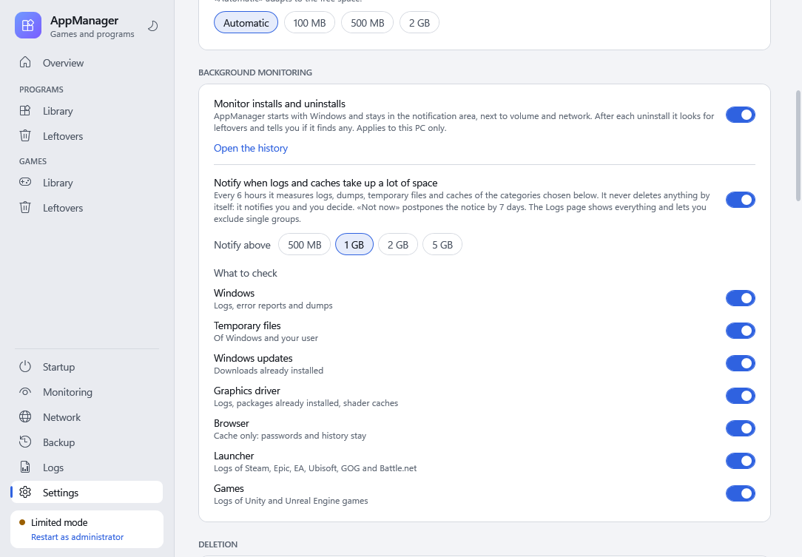

## Безопасность

- **Ничего не удаляется без вашего подтверждения.** Вы всегда видите полный список с причиной и степенью уверенности для каждого элемента.
- **Корзина и резервная копия**: по умолчанию удалённые файлы попадают в Корзину, в отдельную папку для каждого приложения, с полными путями. Туда же сохраняются системные записи — в виде файлов `.reg`, `.xml` и `.txt`. Сохранения, настройки и системные записи также копируются в zip-архив, который можно восстановить в разделе **Резервные копии**. Если копия не удалась, очистка не начинается.
- **Защищённые области**: Windows, основные папки Program Files и ProgramData, компоненты Windows, папки пользователя («Документы», «Рабочий стол», «Загрузки», AppData…), системные папки в корне дисков, лаунчеры и папки всех установленных игр и программ. Папка, содержащая защищённую, никогда не удаляется.
- **Ссылки никогда не открываются**: удаляется только сама точка соединения или символическая ссылка, но не то, на что она указывает.
- **Необычные пути** (короткие имена, переменные, `..`, сетевые пути и `\\?\`) перед любой проверкой приводятся к настоящему пути или отклоняются. Пути длиннее 260 символов поддерживаются.
- **Только одна копия программы одновременно**, настройки сохраняются атомарно, каждая операция записывается в журнал действий.

## Конфиденциальность

AppManager выходит в интернет только для поиска обложек игр и папок сохранений. Для сохранений он обращается к PCGamingWiki и отправляет только название игры. Оба поиска можно отключить. Необязательный ключ SteamGridDB отправляется только в SteamGridDB. Телеметрии нет. Каждый ПК распознаётся по анонимному отпечатку его идентификатора Windows; сам идентификатор никогда не сохраняется и не отправляется.

## Языки

English, Italiano, Français, Deutsch, Español, Русский, Українська. Язык выбирается по Windows (английский, если нужного нет) и меняется в настройках.

## Скачивание и использование

1. Скачайте `AppManager.exe` со страницы [последней версии](../../releases/latest).
2. Положите его в любую папку, даже на флешку, и запустите. Windows запросит права администратора; они нужны для Prefetch, системных разделов реестра, служб, системных заданий планировщика и правил брандмауэра. Без них AppManager работает в «Ограниченном режиме» и всё равно находит и очищает данные вашего пользователя.

Требования: Windows 10 или 11. Используется .NET Framework 4.8, уже входящий в Windows. Для обновления замените `AppManager.exe`: папка `Dati` останется.

**Клавиатура**: Ctrl+F поиск · F5 обновить · Del удалить выбранный элемент (открывает только подтверждение) · Esc закрыть · Enter подтвердить (никогда для действий, которые что-то удаляют).

## Сборка из исходного кода

Visual Studio не нужна: достаточно компилятора C#, входящего в Windows (C# 5, .NET Framework 4.8).

```
cd Source
powershell -ExecutionPolicy Bypass -File build.ps1
```

`build.ps1 -AsInvoker` собирает `bin\AppManager.Test.exe` без запроса прав администратора, для тестов. `build.ps1 -Harness` также собирает `tools\Harness.exe`, консольный инструмент проверки:

| Команда | Что проверяет |
|---|---|
| `robust <папка>` | крайние случаи: защищённые пути, ссылки, длинные пути, имена в Unicode, заблокированные файлы, изменённые резервные копии (только тестовые данные) |
| `invariants` | только чтение: всё, что анализы предлагают на этом ПК, соблюдает правила безопасности |
| `savetest <папка>` | менеджер сохранений: копии, новая игра, смена профиля, откат при ошибке, восстановление |
| `recycletest <папка>` | Корзина, упорядоченная по приложениям, без использования настоящей Корзины |
| `pctest <папка>` | распознавание ПК, ресурсы, автозагрузка, экспорт, переводы, обнаружение пиратских и портативных копий, логика наблюдения |
| `logtest <папка>` | журнал действий |
| `watchtest <папка>` | полная проверка наблюдения с тестовым приложением, которое тест создаёт и затем удаляет |

Для `pctest`, `logtest` и `watchtest` переменная `APPMANAGER_DATA` должна указывать на ту же тестовую папку; для `savetest` и `recycletest` — на другую.

### Структура проекта

```
Source/
  src/core   обнаружение, поиск остатков, очистка, резервные копии, сохранения, наблюдение (без интерфейса)
  src/app    ViewModel для WPF, значок в области уведомлений, сообщения
  ui         XAML (загружается при запуске) и переводы в ui/lang/*.txt
  tools      консольный инструмент проверки (Harness)
  build.ps1  сценарий сборки
docs/images  скриншоты
```

Тексты в коде и XAML написаны на итальянском и служат ключами; переводы находятся в `ui/lang/*.txt`.

## Лицензия

[MIT](LICENSE) © Crover81
